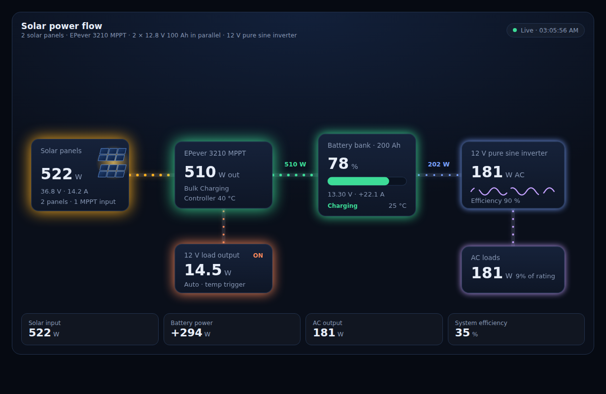
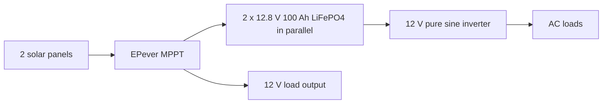
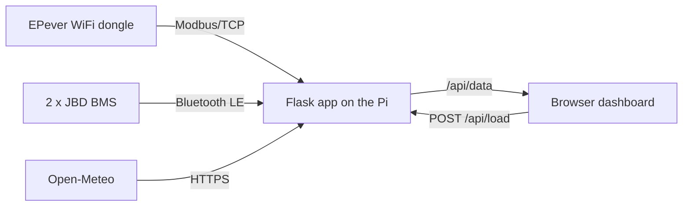

<p align="center">
  
</p>

# Solar Monitor

A self-hosted, headless-friendly dashboard for an off-grid solar system. A small Flask app on a Raspberry Pi reads an **EPever MPPT charge controller** (over its WiFi dongle) and two **JBD/Xiaoxiang BMS** batteries (over Bluetooth LE), adds live weather, and serves a password-protected web page with an animated energy-flow diagram.

<p align="center">
  <br>
  <sub>Energy-flow diagram shown with sample data.</sub>
</p>

## Features

- **Live energy flow:** solar panels → MPPT → battery bank → inverter → AC loads, plus the MPPT's 12 V load output. Particle speed, glow and numbers follow real power.
- **Charge controller data over Modbus/TCP:** PV and battery volts/amps/watts, controller temperature, charge state, lifetime generation (kWh).
- **Two batteries over BLE:** combined voltage, current, power, state of charge and capacity.
- **12 V load control:** manual on/off from the dashboard, plus automatic thermal control (on at ≥ 38 °C, off at ≤ 31 °C, adjustable in `app.py`).
- **Weather:** current conditions and a 7-day forecast from Open-Meteo, with local SVG icons.
- **Spoken alerts:** text-to-speech announcements (gTTS + pygame) for sunrise and similar events.
- **Locked down by default:** login on every route, lockout, CSRF protection and browser security headers (see [Security](#security)).

## How it fits together





The controller has a single PV input, so the dashboard shows the two panels as one combined block.

## Project structure

```
solar_monitor/
├── app.py                    # Flask app: polling threads, API, security layer
├── set_password.py           # Safely sets the dashboard password hash in .env
├── requirements.txt
├── .env.example              # Copy to .env (never commit .env)
├── solar-dashboard.service   # systemd unit for running 24/7
├── templates/
│   ├── index.html            # Your main page
│   └── solar_flow.html       # Energy-flow diagram (included into index.html)
├── static/
│   ├── css/solar_flow.css
│   ├── js/solar_flow.js
│   └── weather-icons/        # SVG icons used by the weather card
├── assets/header.svg         # Animated README banner
└── docs/dashboard-preview.png
```

## Setup

> Built for a Raspberry Pi running headless. Replace paths and the username below with yours.

1. **Clone and install**
   ```bash
   git clone <your-repo-url> solar_monitor && cd solar_monitor
   python3 -m venv venv && source venv/bin/activate
   pip install -r requirements.txt
   ```
2. **Create your settings**
   ```bash
   cp .env.example .env
   chmod 600 .env
   nano .env            # fill in dongle IP, battery Bluetooth addresses, location, username
   ```
3. **Set the dashboard password** (asks twice, writes only the hash):
   ```bash
   python set_password.py
   ```
4. **Run it**
   ```bash
   python app.py
   ```
   The app refuses to start without `DASH_USER` and `DASH_PASS_HASH`. By default it listens on `127.0.0.1` only; from another machine, open an SSH tunnel:
   ```bash
   ssh -L 5001:127.0.0.1:5001 <user>@<pi-address>
   ```
   then browse to `http://localhost:5001`.
5. **Run it 24/7 with systemd**
   ```bash
   sudo cp solar-dashboard.service /etc/systemd/system/    # edit User, paths and the Python path first
   sudo systemctl daemon-reload
   sudo systemctl enable --now solar-dashboard
   journalctl -u solar-dashboard -f
   ```

### Adding the diagram to your own page

In `templates/index.html`:

```html
<!-- in <head> -->
<link rel="stylesheet" href="{{ url_for('static', filename='css/solar_flow.css') }}">

<!-- where the diagram should appear -->


<!-- before </body> -->
<script src="{{ url_for('static', filename='js/solar_flow.js') }}" defer></script>
```

The component polls `/api/data`. Set `maxPv` (combined peak watts of your panels), `maxInv` and `maxLoad` in the `SolarFlow.start({...})` call at the bottom of `solar_flow.js`.

## Configuration (`.env`)

| Variable | Purpose |
|---|---|
| `EPEVER_IP_ADDRESS`, `EPEVER_PORT` | EPever WiFi dongle address and port |
| `BATTERY_1_ADDRESS`, `BATTERY_2_ADDRESS` | Bluetooth addresses of the two BMS units |
| `LATITUDE`, `LONGITUDE`, `TIMEZONE` | Weather location (timezone is URL-encoded, e.g. `America%2FLos_Angeles`) |
| `FLASK_RUN_HOST`, `FLASK_RUN_PORT` | Where the app listens (default host `127.0.0.1`) |
| `DASH_USER`, `DASH_PASS_HASH` | Dashboard login. The hash is created by `set_password.py` |
| `CSP_ALLOW` | Optional: extra `https://` sites the page may load from, space-separated |
| `DASH_DEBUG=1` | Temporary: logs the result of each login check (never the password) |
| `DASH_CSP=off` | Test only: disables the browser security policy |

## API

All routes need the dashboard login.

- `GET /api/data` returns one JSON object (abridged):
  ```json
  {
    "hardware": { "epever_online": true, "bms_online": true, "weather_online": true },
    "weather":  { "temp_f": 89, "condition": "Partly Cloudy", "wmo_code": 2, "is_day": 1 },
    "forecast": [ { "date_raw": "2026-10-17", "wmo_code": 2, "max_temp": 94, "min_temp": 71 } ],
    "solar":    { "v_pv": 36.8, "a_pv": 14.2, "w_pv": 522, "w_bat": 510, "state": "Boost Charging",
                  "device_t": 39.5, "load_status": true, "load_w": 14.5, "thermal_lock": false },
    "bms":      { "soc_avg": 78, "v_combined": 13.3, "a_total": 22.1, "w_total": 294 }
  }
  ```
- `POST /api/load` with JSON `{"action": "ON"}` or `{"action": "OFF"}` switches the controller's 12 V load. It must be sent as JSON and from the dashboard's own origin, and is limited to one toggle every 2 seconds. It is refused while the thermal lock is active.

## Security

- **Login on everything.** Pages, API and static files all require Basic Auth. The password is stored only as a scrypt hash. After 5 failed attempts, logins are locked for 5 minutes.
- **Login cache.** Because scrypt is deliberately slow and Basic Auth resends the password on every request, a verified login is remembered in memory for 10 minutes (`AUTH_CACHE_TTL`). Only a keyed digest is kept; a restart clears it.
- **CSRF protection.** Write requests must be JSON and same-origin.
- **Browser headers.** A Content-Security-Policy, `X-Frame-Options: SAMEORIGIN`, `nosniff` and `no-referrer`. The page can only load scripts and styles from itself, so inline `<script>` blocks and `onclick="..."` attributes will not run. Use `CSP_ALLOW` for any external site you need.
- **Secrets stay out of the repo.** Addresses, location and the password hash live in `.env`, which is git-ignored. The app does not log Bluetooth addresses and `/api/data` never returns them.
- **Recommended around the app:** keep it off the public internet, reach it through [Tailscale](https://tailscale.com) (gives HTTPS) or an SSH tunnel, and put the dongle and BMS on a separate network that only the Pi can reach. HTTP Basic Auth is not encrypted without HTTPS.

## Troubleshooting

| Symptom | Likely cause and fix |
|---|---|
| Login box keeps reappearing | Run with `DASH_DEBUG=1`. `pass_ok=False` with a short `hash_len` means `.env` holds a plain password. Re-run `set_password.py`, then restart (`.env` is read only at startup). |
| "Too many failed attempts" | Wait 5 minutes or restart the app. |
| `waitress.queue: Task queue depth` warnings | Usually many requests at once. The app caches verified logins and runs 8 threads, so repeated warnings point to a slow route or extra open tabs. |
| Main weather icon missing or flickering | Load it with an `` tag and only rebuild it when the icon name changes. An `<object>` SVG is treated as a nested page and is stricter about headers. |
| Page appears unstyled | The security policy is blocking something. Check the browser Console for "Refused to load...", then add the site to `CSP_ALLOW`. |
| Icon returns 404 | File names are case-sensitive on Linux. Check that the name from `getIconFilename()` matches a file in `static/weather-icons/`. |
| No sound under systemd | See the commented `XDG_RUNTIME_DIR` line in the service file and run `sudo loginctl enable-linger <user>`. |

## Known limitations

- **No AC sensor.** The inverter and AC-load figures are estimates (controller output minus 12 V load minus battery charging, times 0.9).
- **Battery temperature is a fixed value** (25 °C) in `app.py`.
- **Combined PV only.** The MPPT reports one PV input, so per-panel values are not available.
- **Voice alerts** use a fixed gTTS language set in `app.py`.

## Safety

This project reads from and writes to electrical equipment (it can switch the controller's 12 V load). Use it at your own risk, keep the dashboard private, and do not depend on it as a protection device. Rely on proper fuses, breakers and your BMS for safety.

## License

Add a license of your choice (for example MIT) before publishing.
